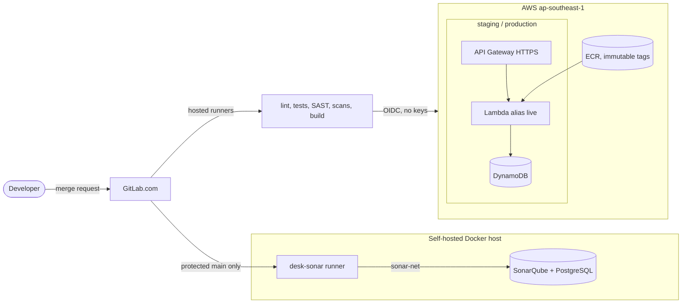
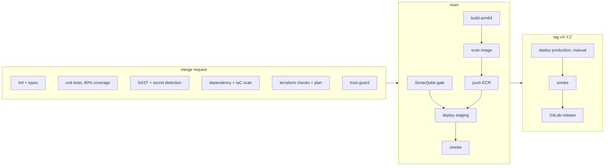
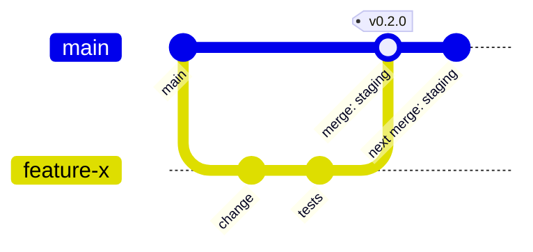

# gitlab-aws-sonar-demo

A teaching project: one small API (`shortlinks`, FastAPI) delivered the way a professional team would, using
GitLab CI, a self-hosted SonarQube quality gate, and AWS (Lambda + API Gateway + DynamoDB, all in Terraform,
deployed without stored AWS keys).

The full step-by-step teaching guide with diagrams is [`docs/guide.html`](docs/guide.html): download it and open it
in a browser (GitHub and GitLab show HTML files as source).

## Use this repository

This is a public copy for learning. The pipeline is **GitLab CI**, so GitHub does not run it: push a copy to your own
GitLab project, then follow the guide.

```bash
git clone https://github.com/phungmanhcuong/gitlab-aws-sonar-demo.git && cd gitlab-aws-sonar-demo
git remote add gitlab git@gitlab.com:<your-group>/gitlab-aws-sonar-demo.git
git push gitlab main
```

Before the first pipeline: run `infra/bootstrap/bootstrap.sh` with your own AWS admin credentials (fill in
`infra/bootstrap/bootstrap.env` from the `.example`), set the CI/CD variables it prints, and set up SonarQube with
`sonar/setup.sh` on a Docker host you control. No account IDs, endpoints or tokens are stored in this repository:
everything comes from your own CI/CD variables.

> **Exercise branches are broken on purpose.** `exercise/01..05` add untested code, a weak random generator, a
> fake credential (generated by `scripts/plant_fake_key.py`, never committed here), a dependency with known CVEs and a
> broken release. Use them in your own GitLab project to watch the pipeline catch each one; never deploy them.

## Architecture



## Pipeline



## Branches, releases, rollback



- `main` is protected: changes arrive through merge requests with a green pipeline and resolved threads.
- Every merge to `main` deploys to **staging**. A protected tag `vX.Y.Z` on a commit of `main` deploys that
  same image to **production** after a manual click.
- Rollback: Deployments > Environments > the environment > **Re-deploy** an older deployment.

## Layout

| Path | What |
|---|---|
| `app/` | FastAPI service, tests, `Dockerfile` (one image for laptop and Lambda) |
| `ci/` | pipeline parts included by `.gitlab-ci.yml` |
| `infra/bootstrap/` | one-time AWS setup by an admin: state bucket, OIDC roles, permissions boundary |
| `infra/stacks/shared/` | ECR repository |
| `infra/stacks/service/` | one environment: Lambda, API Gateway, DynamoDB, logs, alarms |
| `sonar/` | SonarQube + PostgreSQL (Docker Compose) and the `desk-sonar` runner |
| `scripts/` | security gate for GitLab reports, smoke test |
| `docs/adr/` | architecture decisions |

## Quick start (local)

```bash
make setup     # uv sync
make check     # ruff, mypy, pytest (80 % coverage floor)
make run       # http://127.0.0.1:8080/docs, in-memory store
```

## License

MIT, see [LICENSE](LICENSE).
